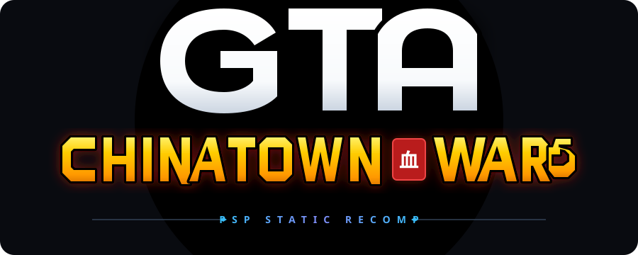

<p align="center">
  
</p>

# ReGTA CTW — ReGTA CTW PSP Recomp

[](CHANGELOG.md)
[](docs/STATUS.md)
[](#build-and-run)
[](#repository-layout)
[](LICENSE)
[](https://fr.tipeee.com/benji-paname/)
[](https://paypal.me/BenjiLsg)

**ReGTA CTW PSP Recomp** — portage et recompilation statique native en pur Rust de *Grand Theft Auto: Chinatown Wars* PSP (version Europe **ULES-01347, version 1.01**).

**par Benji Paname**

> 🛑 **Note importante de distribution** : Ce projet est actuellement en phase de développement fermé (Pré-Alpha v0.1.4). **Aucun fichier binaire exécutable, aucune ROM ni aucun asset propriétaire n'est téléchargeable pour le moment.** Le code source de recherche est documenté en toute transparence. Vous pouvez soutenir activement l'accélération du développement via les liens de don ci-dessous !

---

## 💛 Soutenir le Projet & Accélérer le Développement

Pour permettre à **Benji Paname** de consacrer un maximum de temps au reverse engineering, à l'analyse du code Allegrex MIPS et à l'acquisition du matériel de test :

- 🧡 **[Faire un don ou s'abonner sur Tipeee (Mensuel / Suivi)](https://fr.tipeee.com/benji-paname/)**
- 💙 **[Don direct immédiat via PayPal.Me](https://paypal.me/BenjiLsg)**

---

ReGTA CTW vise à reconstruire le comportement du jeu PSP en code natif Windows x64 pur. Il lit les données du jeu directement depuis l'ISO originale de l'utilisateur sans émuler le CPU PSP (0% d'overhead d'émulation). Le projet s'appuie sur les recherches d'ingénierie inverse et la décompression des 166 code overlays du conteneur `OVERLAYS.PAK`.

🌐 **Site vitrine officiel (GitHub Pages)** : Consultez [`docs/index.html`](docs/index.html) pour la vitrine interactive complète avec le logo officiel, la matrice des systèmes et la feuille de route.

## Build and run

Requirements: Windows x64, a Rust toolchain with a matching Windows linker, and a legally obtained personal ISO of the supported PSP release. The current local validation uses Rust 1.90.0 with the GNU Windows target. Cargo dependencies are pinned in `Cargo.lock`.

From the repository root, in PowerShell:

```powershell
.\Compiler.ps1 -Test
.\outputs\CTW-Rust\CTW-Rust.exe --iso "D:\Games\Chinatown-Wars-PSP.iso" --slice
```

The compiler runs with warnings treated as errors, tests the workspace, and updates the executable only after success. Unit tests use generated synthetic fixtures and do not require an ISO or extracted game tables. Local validation on **24 October 2026: 119 passed, 0 failed, 0 ignored, 0 compiler warnings**. This is a local result, not a hosted CI badge.

For desktop launchers, set `CTW_ISO` in the launching environment or pass `--iso` to a launcher:

```powershell
.\outputs\CTW-Rust\Presenter-la-demo.cmd --iso "D:\Games\Chinatown-Wars-PSP.iso"
```

The existing `outputs/CTW-Rust/Compiler.ps1 -Test` entry point remains supported. The executable keeps its technical name `CTW-Rust.exe` for existing shortcuts; the Cargo package is `regta-ctw`. Build cache: `target/`. See [build instructions](docs/BUILDING.md) for portable toolchains, offline builds, private integration checks and troubleshooting.

## Current scope

| Area | Current implementation | Remaining work |
| --- | --- | --- |
| Resources and world | PSP ISO/WAD/PAK readers, textures, models, map and collisions | Continue format validation and completeness checks |
| Player and cameras | Movement, rolling, obstacle traversal, PSP/mobile/DS camera profiles | Establish remaining PSP behaviour and collision parity |
| Navigation and HUD | PSP radar resources, health/armour display, route guidance, large map | Finish original interface behaviour and GPS fidelity |
| Pedestrians and props | PSP pavement graph, population and prop systems | Validate AI decisions and interactions against PSP |
| Vehicles and combat | Driving, traffic, weapons, explosions and police prototypes | Replace unverified behaviour and Android reference dependencies |
| Sound, weather and statistics | Native audio infrastructure, radio/weather managers, stats structures | Verify integration, PSP provenance and complete save support |
| Full game progression | Not complete | Missions, scripting and complete campaign/save behaviour |

The three camera profiles, French/English interface, keyboard/XInput controls and optional locally supplied HD replacements remain available. No texture pack is included in this repository.

## Repository layout

```text
src/                     Active Rust implementation and unit tests
tools/build/             Canonical compiler implementation
tools/maintenance/       Storage audit, cleanup and repository checks
tools/research/          Index of preserved local research scripts
docs/                    Build, status, release and research documentation
data/tables/             Private local tables (ignored; provenance documented)
references/              Source references and provenance, no game binaries
outputs/CTW-Rust/        Compatibility manifest, launchers and local executable
work/                    Preserved private research (ignored)
target/                  Single regenerable Cargo cache (ignored)
```

The root Cargo workspace retains the package manifest under `outputs/CTW-Rust/` so existing build commands continue to work. The implementation has a single source location: `src/`.

## Support the project

Support **Benji Paname's reverse-engineering, documentation and native-port development**:

- **[Support on Tipeee](https://fr.tipeee.com/benji-paname/)**
- [One-time support through PayPal.Me](https://paypal.me/BenjiLsg)

Contributions are optional. They do not purchase the game, provide game assets or grant rights to Rockstar's intellectual property. No game download, completion date or access tier is promised in exchange. These links were supplied by the project owner.

## License and provenance

Source code: **GPL-3.0-only**. See [LICENSE](LICENSE) and [THIRD_PARTY.md](THIRD_PARTY.md) for upstream work and component credits.

This repository contains no ISO, decrypted PSP executable, extracted game archive, texture pack or audio asset. Optional private tables and research artifacts are excluded from Git. Supply your own supported game copy; do not submit proprietary resources in issues or pull requests.

This is an independent fan research project, not affiliated with or endorsed by Rockstar Games or Take-Two Interactive. Game assets and trademarks remain the property of their respective owners.

[Changelog](CHANGELOG.md) · [Release process](docs/RELEASING.md) · [Developer handoff](outputs/CTW-Rust/AI_HANDOFF_GUIDE.md)
